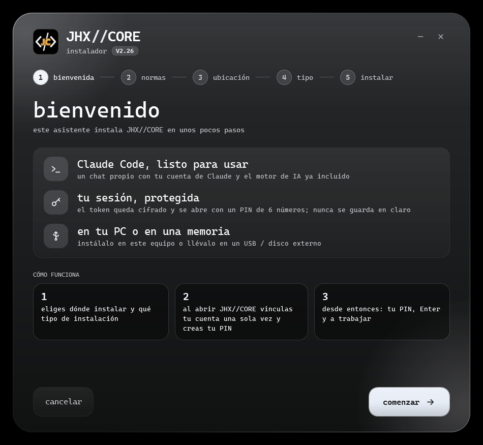
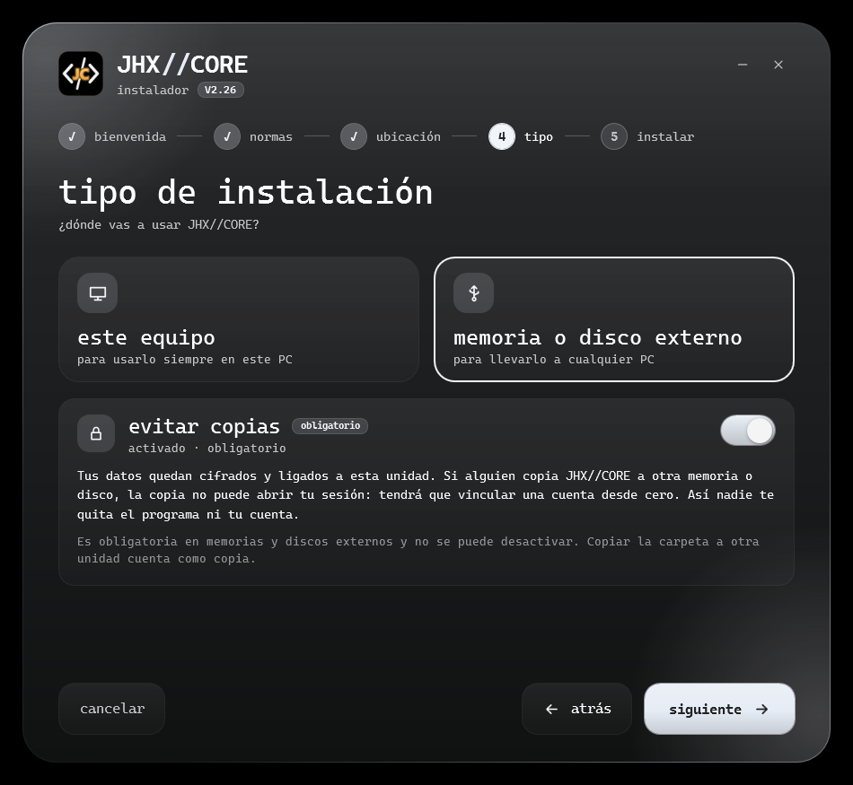

# JHX//CORE

**Claude Code portátil, con tu cuenta protegida por un PIN.**
Un chat propio para usar Claude Code en tu PC o en una memoria USB, listo en minutos.

[**⬇ Descargar la última versión**](../../releases/latest) · [Guía de instalación](docs/instalacion.md) · [Primeros pasos](docs/primeros-pasos.md) · [Preguntas frecuentes](PREGUNTAS-FRECUENTES.md)

---

## Qué es

JHX//CORE es una aplicación para Windows que te da un **chat propio para Claude Code**, con el motor de IA ya incluido. Vinculas tu cuenta de Claude una sola vez, creas un PIN de 6 números y desde entonces solo escribes tu PIN y trabajas.

- **Listo para usar:** el instalador trae Claude Code adentro; no hay que instalar nada más.
- **Tu sesión, protegida:** tu token queda cifrado y se abre con tu PIN. Nunca se guarda en claro. Al vincular, el token se recibe automáticamente al autorizar en el navegador (sin consolas ni copiar y pegar).
- **En tu PC o en una memoria:** instálalo en este equipo o llévalo en un USB / disco externo y úsalo en cualquier PC.
- **Evitar copias:** si alguien copia o mueve el programa, la sesión vinculada se cierra y hay que vincular otra vez. [Cómo funciona](docs/evitar-copias.md).
- **Tú mandas:** eliges qué puede hacer Claude sin preguntarte (preguntar siempre, preguntar solo lo peligroso o permitir todo).
- **Historial de conversaciones** en tu equipo, con fotos y archivos adjuntos (también arrastrando y soltando).
- **Mis proyectos:** vuelve con un clic a las carpetas donde ya trabajaste.
- **Actualizaciones seguras:** el programa busca versiones nuevas, las comprueba con la firma del autor y **siempre te pregunta antes** de instalarlas. Lo mismo con Claude Code.
- **Personalizable:** elige el color del programa y del chat.
- **Recorrido guiado** la primera vez, con cada botón explicado paso a paso.

## Capturas

| Instalador | Tipo de instalación |
|:---:|:---:|
|  |  |

## Instalar

1. Descarga **`JHXCORE-Setup-V….zip`** desde [Releases](../../releases/latest).
2. Extrae el zip y abre **`Instalar JHXCORE.exe`**.
3. Sigue el asistente: normas de uso → carpeta → tipo de instalación → instalar.

> Windows puede mostrar «Windows protegió su equipo» la primera vez, porque el instalador es nuevo y no tiene firma de editor comercial. Pulsa **Más información → Ejecutar de todas formas**.

Guía completa con todas las opciones: [docs/instalacion.md](docs/instalacion.md).

## Requisitos

- Windows 10 o 11 de 64 bits.
- **Un plan de Claude de pago: como mínimo Claude Pro** (también sirven Max, Team y Enterprise) con acceso a Claude Code. Para vincular la cuenta, JHX//CORE usa el *token de validación* de Claude (`setup-token`), y Anthropic solo lo entrega a cuentas con suscripción: **el plan gratuito no lo incluye**.
- Unos 400 MB libres (en la unidad que elijas).
- Internet para vincular la cuenta y para usar Claude (el programa en sí no la necesita).

## Reportar un problema

Dentro del programa hay un botón **«reportar un problema»** (la banderita de arriba): te explica cómo escribirme y copia los datos de tu versión.
También puedes abrir un [reporte aquí en GitHub](../../issues/new/choose).

## Normas de uso y licencia

Léelas antes de instalar: [NORMAS-DE-USO.txt](NORMAS-DE-USO.txt) · [LICENSE.txt](LICENSE.txt).

JHX//CORE **no es un producto oficial de Anthropic**. Claude y Claude Code son marcas y servicios de Anthropic; úsalos conforme a sus términos.
