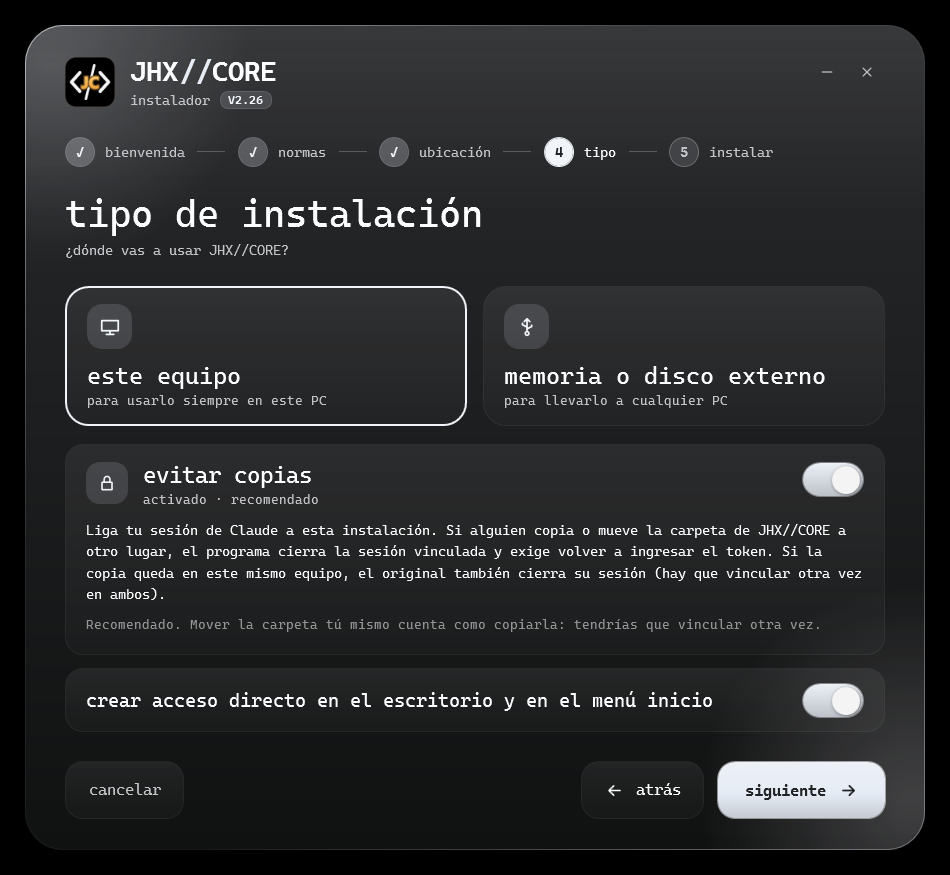
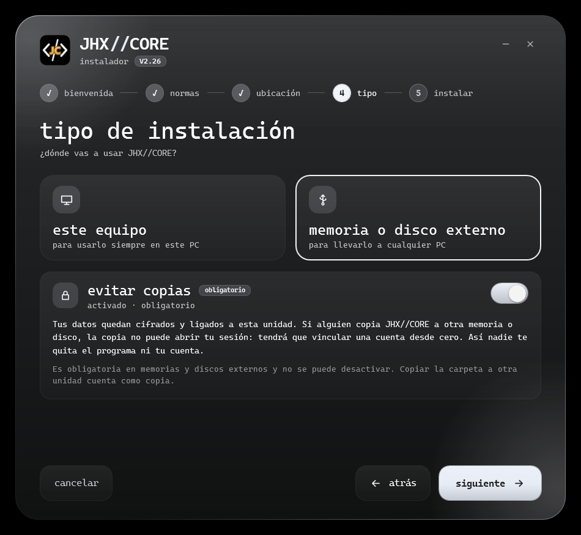

# Guía de instalación

## 1 · Descargar

En [Releases](../../../releases/latest) descarga **`JHXCORE-Setup-V….zip`** (el otro archivo, «JHXCORE V… Portable.exe», es solo para las actualizaciones automáticas y no hace falta descargarlo).

Extrae el zip. Dentro encontrarás:

```
JHXCORE Setup/
├── Instalar JHXCORE.exe     ← el instalador
├── LEEME.txt
└── NORMAS DE USO.txt
```

## 2 · El asistente

Abre **`Instalar JHXCORE.exe`**. Son cinco pasos:

| Paso | Qué pasa |
|---|---|
| **1 · Bienvenida** | Resumen de qué es JHX//CORE y cómo funciona. |
| **2 · Normas** | Léelas y acepta para continuar. |
| **3 · Ubicación** | Elige la carpeta donde se creará `JHXCORE`. Por defecto va a tu perfil de usuario (no pide permisos de administrador). |
| **4 · Tipo** | «Este equipo» o «memoria o disco externo» (ver abajo), y la opción **evitar copias**. |
| **5 · Instalar** | Resumen, instalación y listo. Puedes abrir el programa desde el mismo instalador. |

<div align="center">
 &nbsp; 
</div>

## 3 · Elegir el tipo de instalación

### Este equipo
Para usarlo siempre en este PC.
- **Evitar copias:** opcional (recomendada).
- Puedes crear accesos directos en el escritorio y en el menú inicio.

### Memoria o disco externo
Para llevarlo a cualquier PC.
- **Evitar copias:** **obligatoria** (no se puede desactivar). Así nadie puede llevarse el programa de tu memoria.
- En la carpeta solo se ve el programa; lo demás queda oculto.
- Instálalo con la memoria conectada y elígela en el paso «Ubicación».

> Si eliges una unidad extraíble en el paso «Ubicación», el instalador te propone automáticamente este tipo.

## 4 · Después de instalar

1. Abre JHX//CORE. La primera vez te muestra un **recorrido guiado** (puedes omitirlo).
2. Pulsa **vincular** y sigue los pasos: inicias sesión, pegas tu token y creas tu PIN de 6 números.
3. Escribe tu PIN y pulsa Enter.

Más detalle: [primeros pasos](primeros-pasos.md).

## Actualizar y desinstalar

- **Actualizar:** el programa te avisa solo y te pregunta antes. También está el botón «actualizar JHX//CORE».
- **Desinstalar:** cierra el programa y borra la carpeta `JHXCORE` (y los accesos directos si los creaste).
